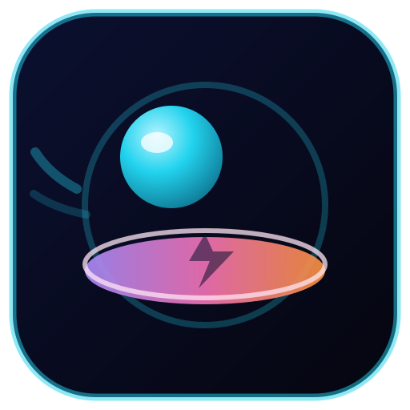

# Bounce & Smash 💥

Arcade de **físicas casuales**: arrastra hacia atrás, suelta y lanza una bola
elástica contra una torre de discos en hélice. Si la bola cae sobre un disco con
suficiente fuerza, lo **destruye** y encadena combos; si cae despacio, rebota.

Hecho con **Godot 4.3**, sin texturas ni audio externos (todo se dibuja por
código) y con un workflow de **GitHub Actions** que compila el APK y lo deja
como artefacto y como Release descargable. **No hace falta instalar nada en tu
PC**: la compilación ocurre en los runners de GitHub.



## Cómo se juega

| Acción | Resultado |
|---|---|
| Arrastrar hacia atrás y soltar | Lanza la bola en sentido contrario al arrastre |
| Arrastrar y mover sin soltar | Muestra la trayectoria prevista y el medidor de potencia |
| Toque corto (< 24 px) | Se cancela el lanzamiento |
| Perder el foco de la app | Pausa automática; toca para continuar |
| Reintentar | Cada lanzamiento termina solo cuando la bola se detiene o cae fuera |

- **La bola rebota** con un `PhysicsMaterial` de rebote alto y choca con las
  paredes laterales.
- **Los discos se rompen** solo con impactos descendentes por encima del umbral
  (`650 px/s` en el nivel 1, `+70 px/s` por nivel, tope `1300`).
- **Los impactos lentos** hacen parpadear el disco y rebotan sin romperlo.
- La torre se organiza en **hélice**: hay que colarse por los huecos laterales,
  rebotar y caer sobre los discos para destruirlos.
- **Combo**: cada disco roto en el mismo vuelo multiplica los puntos
  (`10`, `20`, `30`…). Limpiar la torre da `100 × nivel` de bonus.
- El nivel siguiente añade discos (hasta 8) y sube el umbral.
- El **récord** y el **nivel máximo** se guardan en
  `user://bounce_smash_save.json` dentro del teléfono.

## Compilar el APK en GitHub (paso a paso)

1. **Crea el repositorio vacío** en GitHub: <https://github.com/new>.
   - Nombre sugerido: `bounce-and-smash`. No marques "Add a README".
2. **Sube este proyecto** (desde la carpeta del proyecto):

   ```bash
   git remote add origin https://github.com/<TU_USUARIO>/bounce-and-smash.git
   git push -u origin main
   ```

   Si te pide credenciales, usa un **Personal Access Token** (GitHub → Settings →
   Developer settings → Tokens (classic) → `repo`) como contraseña, o configura SSH.
   También puedes subir los archivos desde la web de GitHub ("Add file → Upload files").
3. Entra a la pestaña **Actions → Build APK** del repositorio. El push a `main`
   dispara el build automáticamente (tarda ~4-6 min; casi todo es descargar la
   imagen con Godot + Android SDK).
4. Cuando el run esté en verde, abre el run y descarga el artefacto
   **`bounce-and-smash-apk`** (es un `.zip` con `bounce-and-smash.apk`).
5. Instala el APK en el teléfono (activa "Instalar apps de origen desconocido"
   para tu explorador de archivos). Está firmado en modo **debug**: sirve para
   probar, no para publicar en Play Store.
6. Para volver a compilar sin cambiar código: **Actions → Build APK → Run workflow**.

### Descarga directa (Releases)

Cada tag `v*` compila y publica un **Release** con el APK adjunto, así se puede
descargar sin iniciar sesión:

<https://github.com/linuxcoro/bounce-and-smash/releases/latest>

Para publicar una versión nueva:

```bash
git tag v1.0.1
git push origin v1.0.1
```

### Qué revisa el workflow

- Prepara Godot 4.3 + export templates + Android SDK + keystore debug dentro del
  contenedor `barichello/godot-ci:4.3`.
- Importa recursos y exporta el preset `Android Debug` a `build/bounce-and-smash.apk`.
- Verifica que el APK exista y muestra su `package`/`versionName` con `aapt`.
- Publica el APK como artefacto y, **después** de subirlo, corre un smoke test
  headless de la lógica. Si el smoke test falla, el run queda en rojo pero el APK
  ya está descargable en el artefacto (útil para diagnosticar sin bloquear la entrega).
- Si el push fue de un tag `v*`, espera al build y crea/actualiza el Release con el
  APK adjunto (job `release`, con `contents: write` solo en ese job).

## Estructura

```
project.godot              Configuración: 720x1280, portrait, GL Compatibility
export_presets.cfg         Preset "Android Debug" (APK precompilada + firma debug)
icon.svg                   Icono vectorial (lo usa el launcher de Android)
scenes/Main.tscn           Escena raíz mínima (solo un Node2D con game.gd)
scripts/game.gd            Estados, puntaje/combo, niveles, guardado y pausa
scripts/ball.gd            RigidBody2D, material de rebote, CCD, estela
scripts/launcher.gd        Drag & release, goma, potencia y trayectoria
scripts/trajectory.gd      Lógica pura de lanzamiento y predicción (testeable)
scripts/tower.gd           Pool fijo de plataformas y torre en hélice
scripts/platform.gd        Disco destructible: collider + sensor + umbral
scripts/effects.gd         Pools fijos de fragmentos/chispas + screen shake
scripts/arena.gd           Fondo neón, paredes y pad de lanzamiento
scripts/hud.gd             Marcador, récord, nivel, combo, banners y pausa
tests/smoke.gd             Prueba headless de lógica e integración
.github/workflows/build-apk.yml  CI que produce el APK
```

## Optimización de memoria (object pooling)

- La torre se construye **una sola vez** con 12 nodos `StaticBody2D`. Al cambiar
  de nivel se reposicionan y reactivan las **mismas instancias** (mismos IDs),
  incluidas las que estaban destruidas: no hay `new()` ni `queue_free()` en partida.
- Fragmentos, chispas y números flotantes viven en arrays de tamaño fijo
  (`240`, `180`, `24`) con ring buffer; se dibujan en un único `_draw()`.
- La estela de la bola está acotada a 26 muestras.
- Objetivo: 60 FPS estables y sin picos del recolector de basura en móviles modestos.

## Balance y ajustes rápidos

| Constante | Dónde | Efecto |
|---|---|---|
| `THRESHOLD_BASE` / `THRESHOLD_STEP` | `tower.gd` | Fuerza de caída necesaria para romper |
| `THRESHOLD_MAX` | `tower.gd` | Tope del umbral por nivel |
| `BASE_DISCS` / `MAX_DISCS` / `TOP_MARGIN` | `tower.gd` | Cantidad de discos y altura de la torre |
| `HELIX_RADIUS` / `SPACING` (calculado) | `tower.gd` | Forma de la hélice |
| `MAX_PULL` / `MIN_SPEED` / `MAX_SPEED` | `trajectory.gd` | Potencia y velocidad del lanzamiento |
| `RADIUS` / `bounce` | `ball.gd` | Tamaño y elasticidad de la bola |
| `MAX_FRAGMENTS` / `MAX_SPARKS` | `effects.gd` | Coste de partículas |
| `SETTLE_TIME` / `FLIGHT_TIMEOUT` | `game.gd` | Cuándo se da por terminado un lanzamiento |

## Pruebas locales

Descarga Godot **4.3** (standard, sin .NET) desde
<https://godotengine.org/download/archive/4.3-stable/> y ejecuta:

```bash
godot --headless --path . --import
godot --headless --path . --script res://tests/smoke.gd
```

El smoke test comprueba la zona muerta del arrastre, la predicción de la
trayectoria, el umbral de rotura (rápido rompe, lento y ascendente no), el
puntaje con combo, la reutilización de instancias de la torre, los topes de los
pools, el guardado/récord y una caída real contra el sensor de un disco.

## Abrir el proyecto en Godot (opcional)

1. Project Manager → Import → selecciona `project.godot`.
2. F5 para probar en escritorio (clic izquierdo = toque).
3. Para exportar por tu cuenta: Editor → Manage Export Templates → instalar
   templates de 4.3 y configurar el SDK de Android como explica la
   [documentación oficial](https://docs.godotengine.org/en/4.3/tutorials/export/exporting_for_android.html).

## Solución de problemas

| Síntoma en el log de Actions | Qué hacer |
|---|---|
| `No export template found at ...` | Cambia `4.3` en el `image:` del workflow y en el preset, o revisa el paso "Preparar Godot..." (`ls` de plantillas). |
| `Android build template not installed` | El preset debe tener `gradle_build/use_gradle_build=false` (este repo ya lo trae). |
| `Unable to find apksigner` | Revisa que `/usr/lib/android-sdk/build-tools` exista (el paso de preparación lo imprime). |
| `Could not find keystore` | Borra `$HOME/.config/godot` en el paso de preparación para que se reescriba `editor_settings-4.3.tres`. |
| `Export successful` pero el juego no arranca | Revisa el smoke test y el log `--verbose` del export; los errores de GDScript aparecen ahí. |
| Run en rojo por Docker Hub | Re-ejecuta el workflow desde la UI ("Re-run jobs"); es un límite de pulls. |

## Publicar en Play Store (fuera de alcance)

El APK actual va firmado con la clave debug del contenedor. Para publicar haría
falta un keystore de release (base64 en GitHub Secrets), `export_presets.cfg`
con `keystore/release*` y `version/code` incrementado. Este repo deja el camino
de compilación listo para añadirlo.

## Licencia

MIT — ver [LICENSE](LICENSE).
